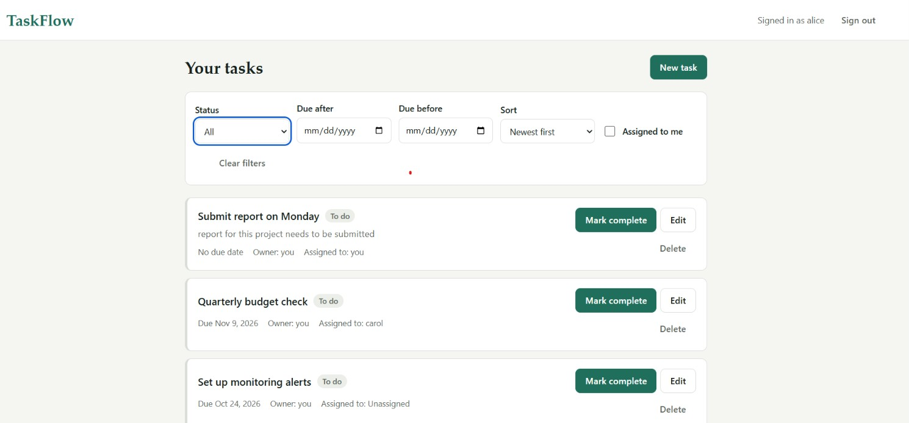
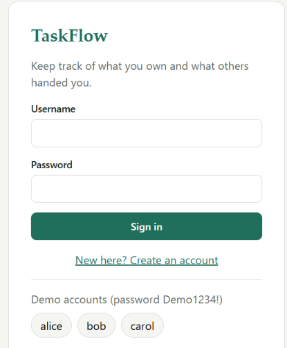
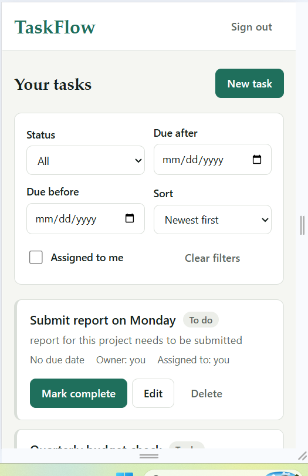
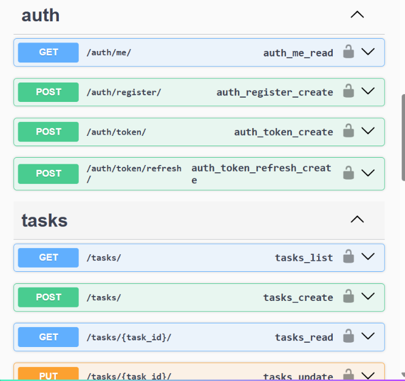

# TaskFlow: task management API + React UI

TaskFlow is a full-stack task manager built with Django REST Framework, React, Vite, and TypeScript.

## Quick start

```sh
git clone https://github.com/shubraj04/TaskFlow-App-mngmt.git
cd TaskFlow-App-mngmt
docker compose up --build
```

- App: http://localhost:3000
- Swagger UI: http://localhost:3000/api/docs/
- Demo logins: `alice`, `bob`, or `carol` / `Demo1234!`

## Screenshots

| Task list | Filters |
|---|---|
|  |  |
| **Login**<br> | **Mobile view**<br> |



## Prerequisites

- Docker Desktop for the containerized setup.
- For local runs without Docker: Python 3.11+ and Node.js 20+.

## Environment variables

| Variable | Purpose | Default |
|---|---|---|
| `POSTGRES_HOST` | Enables PostgreSQL when set; otherwise SQLite is used. | Unset (SQLite); Compose sets `db`. |
| `REDIS_URL` | Cache and Celery broker/backend URL. | Unset (local memory); Compose sets `redis://redis:6379/0`. |
| `THROTTLE_USER` | Authenticated-user request rate limit. | `300/min` |
| `THROTTLE_ANON` | Anonymous request rate limit. | `60/min` |
| `THROTTLE_AUTH` | Login and registration rate limit. | `10/min` |
| `DJANGO_SECRET_KEY` | Django signing key. | `dev-insecure-key-change-me` (Compose overrides this). |
| `DJANGO_DEBUG` | Enables Django debug mode. | `true` (Compose sets `false`). |

## Troubleshooting

- Ports already in use: stop the process using port 3000 (frontend), 8000 (backend), or 5432 (PostgreSQL), or change the Compose port mapping.
- Restore the demo users and sample tasks: `docker compose exec backend python manage.py seed_demo`.
- Reset the database and recreate the stack: `docker compose down -v` followed by `docker compose up --build`.
- Local backend setup requires Python 3.11 or newer.

| Requirement | Where |
|---|---|
| CRUD, assign, complete, filter by status/due date | `backend/apps/tasks/presentation/views.py` |
| JWT auth (access + refresh) | `djangorestframework-simplejwt`, `/api/auth/*` |
| Pagination | envelope `{count, next, previous, results}`, `page` / `page_size` (max 100) |
| PostgreSQL or SQLite | Postgres when `POSTGRES_HOST` is set (Docker), SQLite otherwise |
| Tests, >= 80% coverage | 62 tests, ~99% coverage, enforced by `--cov-fail-under=80` |
| Docker + compose | `docker-compose.yml` (db, redis, backend, worker, beat, frontend) |
| Swagger / drf-yasg | `/api/docs/` (Swagger UI), `/api/redoc/` |
| Rate limiting | DRF throttling: anon 60/min, user 300/min, login/register 10/min (env-configurable) |
| Background processing | Celery + Redis: assignment e-mail, hourly due-soon reminders (beat) |
| pyproject, pre-commit, lint | `backend/pyproject.toml`, `.pre-commit-config.yaml`, ruff |
| Frontend | `frontend/` React + TS, responsive, full CRUD, filters, pagination |
| Seed data | `python manage.py seed_demo` (runs automatically in Docker) |
| GenAI section | [`docs/GENAI.md`](docs/GENAI.md) |
| Thought process | [`docs/THOUGHT_PROCESS.md`](docs/THOUGHT_PROCESS.md) |

## Run it with Docker (recommended)

```bash
docker compose up --build
```

- App: http://localhost:3000
- Swagger: http://localhost:3000/api/docs/ (or :8000/api/docs/)
- Demo logins (seeded automatically): `alice`, `bob`, `carol`, password `Demo1234!`

Assignment e-mails are printed to the `worker` container logs (console e-mail backend).

## Run it locally (no Docker)

Backend (SQLite, Celery runs tasks inline, no Redis needed):

```bash
cd backend
python -m venv .venv
# Windows PowerShell
.\.venv\Scripts\Activate.ps1
# macOS/Linux
source .venv/bin/activate
pip install -r requirements-dev.txt
python manage.py migrate
python manage.py seed_demo
python manage.py runserver          # http://localhost:8000
```

Frontend (Vite dev server proxies `/api` to Django):

```bash
cd frontend
npm install
npm run dev                         # http://localhost:5173
```

With `uv` instead of pip: `cd backend && uv sync && uv run python manage.py runserver`.

## Tests, lint, hooks

```bash
cd backend
python -m pytest            # fails below 80% coverage
ruff check . && ruff format --check .
pre-commit install          # from the repo root; also run `pre-commit install --hook-type pre-push`
```

## API overview

| Method | Path | Notes |
|---|---|---|
| POST | `/api/auth/register/` | throttled (10/min) |
| POST | `/api/auth/token/` , `/api/auth/token/refresh/` | JWT pair / refresh |
| GET | `/api/auth/me/`, `/api/users/` | current user, assignee picker |
| GET | `/api/tasks/` | `status`, `due_before`, `due_after`, `assignee`, `ordering`, `page`, `page_size` |
| POST | `/api/tasks/` | create (caller becomes owner) |
| GET / PUT / PATCH / DELETE | `/api/tasks/{id}/` | delete is owner-only |
| POST | `/api/tasks/{id}/assign/` | owner-only; `{"assignee_id": null}` unassigns |
| POST | `/api/tasks/{id}/complete/` | owner or assignee; 409 if already completed |

Errors are JSON: `{"field": "message"}` for validation (400), `{"detail": "..."}` otherwise
(403 permission, 404 missing, 409 conflict, 429 throttled).

## Architecture (Clean Architecture)

```
backend/apps/tasks/
  domain/          Task entity + rules, repository/notifier ports, domain exceptions   (pure Python)
  application/     One use case per intention: Create/Update/Assign/Complete/Delete/Get/List
  infrastructure/  Django ORM model + repositories, Celery tasks, notifier adapter
  presentation/    DRF views & serializers, URL routing, exception->HTTP mapping, composition root
```

Dependencies point inwards only: `presentation -> application -> domain`, and `infrastructure`
implements the domain ports. `presentation/container.py` is the single place where concrete
adapters are wired to use cases. Unit tests exercise the use cases with in-memory fakes
(`tests/unit/fakes.py`), with no database and no Django; integration tests go through HTTP with a real JWT.

Key decisions:

- **Visibility rule:** a user sees only tasks they own or are assigned to. Owner and assignee can
  edit/complete; only the owner can delete or reassign.
- **Domain errors, not HTTP errors:** use cases raise `PermissionDenied`, `TaskNotFound`, ...; one exception
  handler turns them into 403/404/409/400, so use cases stay framework-free.
- **Notifications after commit:** `transaction.on_commit` enqueues the Celery job so the worker never
  races the DB write.
- **Stable pagination:** list ordering always appends `-id` as a tiebreaker.
- **Due-date validation** rejects past dates on create/change, but an unchanged past date is allowed so
  you can still rename an overdue task.
- **Frontend:** `api/` (fetch wrapper with transparent refresh + typed errors) -> `hooks/` (data) ->
  `pages/` -> `components/` (presentational). Aborts stale requests; resets to page 1 on filter change.

## Known limitations / next steps

- JWTs are kept in `localStorage` for simplicity (XSS trade-off). Production: httpOnly refresh cookie.
- Throttle counters use the configured cache (Redis in Docker, per-process memory locally).
- No frontend unit tests yet (Vitest + Testing Library would be the next addition).
- Compose file and Dockerfiles were not executed in the authoring sandbox (no Docker daemon); the same
  services were verified individually (gunicorn with `DEBUG=false` serving Swagger assets, tests on SQLite).
